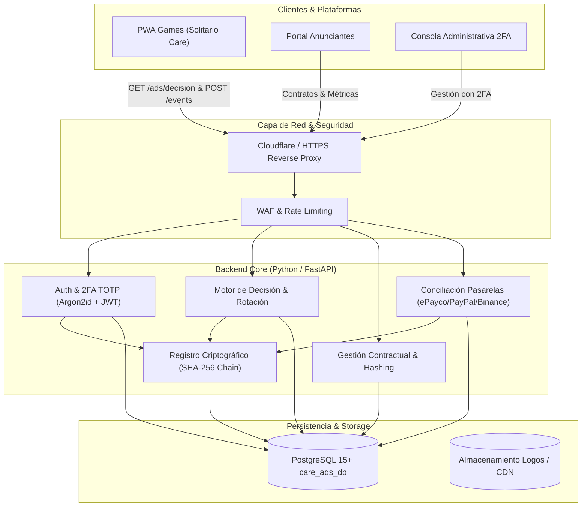

# Arquitectura de Sistema — Care Ads Manager V1.0

## 1. Visión General y Objetivos
Care Ads Manager V1.0 es el sistema empresarial centralizado de gestión publicitaria, contratación digital, recaudo financiero, control de inventario y auditoría criptográfica para la red de aplicaciones y juegos PWA de **CareTech Services**.

El sistema desacopla completamente la lógica publicitaria de los juegos (`solitario`, futuros títulos y portales satélite), eliminando la dependencia de archivos JSON desprotegidos y garantizando que:
- Ninguna campaña se publique sin contrato electrónico aceptado y pago verificado.
- Cada impresión y segundo de exposición se registre bajo el estándar IAB (≥50% de píxeles visibles durante ≥1000ms continuos).
- Toda acción administrativa y cambio de estado quede sellado en un registro inmutable con encadenamiento criptográfico SHA-256.

---

## 2. Componentes del Ecosistema

### 2.1. Backend Core (`care-ads/backend`)
- **Framework**: FastAPI (asíncrono con Python 3.10+ y `uv`).
- **ORM / Conectividad**: SQLAlchemy 2.0 Async + `asyncpg` con `NullPool` para concurrencia limpia.
- **Autenticación**: JSON Web Tokens (HS256) con expiración corta (60 min) y refresh seguro.
- **Seguridad 2FA**: PyOTP (RFC 6238 TOTP) con generación de códigos QR base64 en tiempo real.
- **Criptografía**: Argon2id para contraseñas de usuarios y HMAC SHA-256 para validación de webhooks y encadenamiento de auditoría.

### 2.2. SDK de Integración PWA (`care-ads/sdk/care-ads-pwa/care-ads-sdk.js`)
- **Consumo Inteligente**: Consulta `/api/v1/delivery/decision` con soporte para fallback offline.
- **Medición IAB**: Implementación nativa de `IntersectionObserver` (umbral del 50%) acoplada al `Page Visibility API`.
- **Batching Resiliente**: Agrupamiento de eventos de telemetría y vaciado periódico o mediante `navigator.sendBeacon` al cerrar ventana.

### 2.3. Consola Administrativa (`care-ads/frontend/admin/index.html`)
- Acceso restringido con autenticación de dos factores (2FA / Google Authenticator).
- Monitor de KPIs ejecutivos: campañas en vuelo, ingresos facturados vs no devengados, ratio de cumplimiento.
- Moderación de creatividades: previsualización de logo, título, texto y URL de destino.
- Verificador criptográfico de integridad: escaneo en tiempo real de la cadena de bloques interna SHA-256.

### 2.4. Portal del Anunciante (`care-ads/frontend/advertiser/index.html`)
- Consulta transparente de rendimiento auditado: impresiones IAB y segundos reales visibles.
- Consulta del Contrato Marco Digital V1.0 con estampado del hash de aceptación.
- Descarga e impresión de certificados de cumplimiento contractual.

---

## 3. Principios de Diseño
1. **Zero-Trust**: Ningún dato de cliente ni evento de impresión se asume verídico sin validación criptográfica y de firmas.
2. **Defensa en Profundidad**: Protección en múltiples capas (Rate Limiting, validación de esquemas Pydantic V2, RBAC a nivel de endpoint y consultas preparadas con SQLAlchemy).
3. **Idempotencia Transaccional**: Todo webhook de pago procesado y migración de datos utiliza identificadores únicos universales y transacciones atómicas.
4. **Separación de Responsabilidades**: Desacoplamiento estricto entre el motor de juegos y el negocio publicitario.
