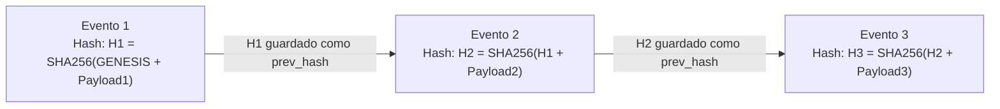

# Modelo de Auditoría Criptográfica — Care Ads Manager V1.0

## 1. Arquitectura de Registro Inmutable (Hash Chain)

Para garantizar valor probatorio pleno ante auditorías tributarias (DIAN), controversias comerciales o litigios ante la Superintendencia de Industria y Comercio (SIC), el sistema implementa una **cadena de bloques criptográfica interna (Append-Only Hash Chain)** en la tabla `audit_events`.



---

## 2. Estructura Canónica del Hash

Cada registro de auditoría calcula su hash criptográfico utilizando la representación canónica estricta de sus campos:

$$\text{payload} = \text{actor\_id} + \text{action} + \text{resource\_type} + \text{resource\_id} + \text{json(prev\_state)} + \text{json(new\_state)} + \text{note} + \text{prev\_hash}$$

$$\text{record\_hash} = \text{SHA256}(\text{payload.encode('utf-8')})$$

### Reglas de Integridad:
1. El primer evento del sistema utiliza como `prev_hash` la cadena `"GENESIS"`.
2. Cada nuevo evento lee el `record_hash` del último registro insertado y lo utiliza como su `prev_hash`.
3. Está terminantemente prohibido ejecutar sentencias `UPDATE` o `DELETE` sobre la tabla `audit_events`. Cualquier intento de alteración rompe la continuidad de la cadena.

---

## 3. Verificación Automatizada de Integridad (`/api/v1/admin/audit/verify`)

El endpoint de verificación realiza un barrido secuencial de todos los registros:
1. Recalcula el hash de cada fila a partir de su payload canónico y su `prev_hash`.
2. Compara el hash recalculado contra el `record_hash` almacenado en base de datos.
3. Verifica que el `prev_hash` de la fila $N$ sea idéntico al `record_hash` de la fila $N-1$.
4. Si se detecta cualquier discrepancia (incluso de un solo caracter en una nota o estado), el endpoint retorna:
   ```json
   {
     "status": "TAMPER_DETECTED",
     "tampered_at_id": "uuid-del-registro",
     "message": "Audit chain verification failed at record uuid"
   }
   ```
5. Si todos los registros coinciden, retorna:
   ```json
   {
     "status": "VERIFIED",
     "total_records_checked": 42,
     "message": "All audit events verified successfully. Hash chain intact."
   }
   ```
Esta funcionalidad cuenta con prueba automatizada en `tests/test_security_and_rbac.py::test_audit_hash_chain_tamper_detection`.
