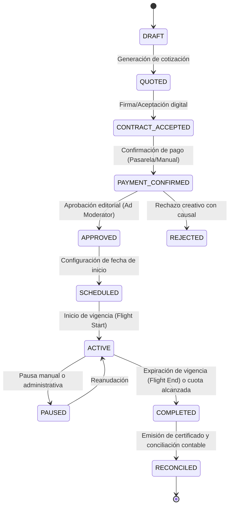

# Reglas de Negocio — Care Ads Manager V1.0

## 1. Principio Fundamental
**"Ningún anuncio se emite sin contrato aceptado, pago verificado y aprobación editorial."**

Cobrar anticipadamente una campaña publicitaria constituye un **pasivo financiero (ingreso diferido o no devengado)** hasta que el servicio sea efectivamente entregado a través de impresiones o tiempo de emisión verificable.

---

## 2. Modelos Comerciales de Publicidad

| Modelo | Definición | Obligación Legal de CareTech | Métrica de Cumplimiento |
| :--- | :--- | :--- | :--- |
| **Modelo A: Tiempo Calendario (Recomendado)** | Derecho a participar en el carrusel de rotación durante un rango de fechas (días/semanas). | Garantizar disponibilidad de los slots de rotación sin interrupciones técnicas imputables a CareTech. | Horas y turnos de emisión programados vs fallas de servicio. |
| **Modelo B: Cuota de Rotación** | Porcentaje reservado de los 60 slots horarios (ej: 1 slot por hora = 1.66% del tráfico). | Asignación estricta del turno dentro de la hora reloj correspondiente. | Registro de turnos asignados y ejecutados por el servidor. |
| **Modelo C: Paquete de Impresiones** | Compra de un volumen garantizado de impresiones válidas (ej: 50,000 visualizaciones). | Mantener la campaña activa hasta entregar el 100% de las impresiones pactadas. | Impresiones IAB auditadas (≥50% área, ≥1000ms visibles). |
| **Modelo D: Híbrido** | Calendario con compromiso mínimo de impresiones. | Exponer durante el periodo contratado y compensar si no se alcanza la cota mínima. | Comparación entre impresiones entregadas vs objetivo pactado. |

> **Nota Operativa V1.0**: En la fase inicial se comercializa exclusivamente el **Modelo A**, permitiendo reportar impresiones y clics como métricas de valor agregado sin comprometer contingencias indemnizatorias por fluctuaciones de tráfico.

---

## 3. Matriz de Estados de una Campaña

---

## 4. Políticas de Precios y Pagos
1. **Moneda Base**: Dólares estadounidenses (USD) con conversión dinámica a Pesos Colombianos (COP) mediante TRM referencial o fijada en configuración.
2. **Precisión Financiera**: Prohibición absoluta de operaciones aritméticas en punto flotante (`float`). Uso obligatorio de `Numeric(12, 2)` en base de datos y `Decimal` en Python.
3. **Planes Estándar (Ejemplo Solitario Care)**:
   - *Plan Semanal*: $10 USD.
   - *Plan Quincenal*: $20 USD.
   - *Plan Mensual*: $35 USD.
   - *Plan Trimestral*: $90 USD.
   - *Tarifa de Prioridad (Bypass)*: +$120 USD (duplica frecuencia de aparición relativa en turnos con alta demanda).
4. **Validación de Pasarelas**:
   - Transacciones vía ePayco, PayPal, MercadoPago o Binance Pay deben contar con firma criptográfica verificada (`x_signature`, IPN VERIFIED, etc.) antes de marcar el pago como `CAPTURED`.

---

## 5. Políticas de Moderación y Contenido
Queda estrictamente prohibida la aprobación de anuncios que promocionen:
- Contenido para adultos o pornografía.
- Apuestas o juegos de azar sin licencia Coljuegos.
- Sustancias psicoactivas o medicamentos de venta bajo fórmula médica sin autorización INVIMA.
- Esquemas piramidales, captación ilegal o estafas cripto.
- Publicidad engañosa que imite botones del juego o alertas del sistema operativo.
