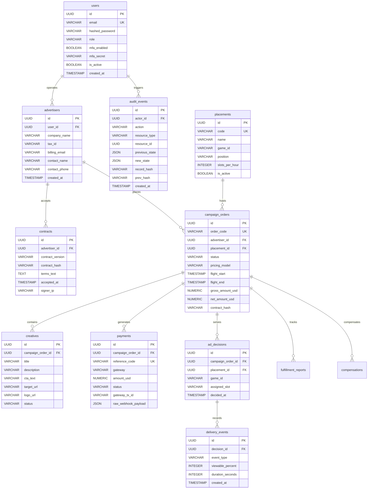

# Esquema de Base de Datos PostgreSQL — Care Ads Manager V1.0

## 1. Configuración de Base de Datos
- **Motor**: PostgreSQL 15+
- **Nombre de Base de Datos**: `care_ads_db`
- **Extensión**: `uuid-ossp` o generación nativa de UUID v4.
- **Herramienta de Migración**: Alembic con versionamiento secuencial (`migrations/versions/`).

---

## 2. Diagrama Entidad-Relación (12 Tablas Normalizadas)

---

## 3. Índices de Alto Rendimiento
1. `idx_orders_status_flight`: Búsqueda de campañas activas en ventana de emisión actual:
   `CREATE INDEX idx_orders_status_flight ON campaign_orders(status, flight_start, flight_end);`
2. `idx_decisions_placement_time`: Agregación de turnos y telemetría por ubicación:
   `CREATE INDEX idx_decisions_placement_time ON ad_decisions(placement_id, decided_at);`
3. `idx_audit_prev_hash`: Verificación secuencial de la cadena de bloques interna:
   `CREATE INDEX idx_audit_prev_hash ON audit_events(prev_hash);`
