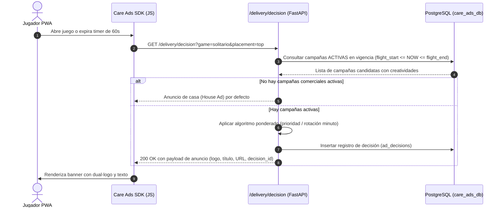

# Motor de Entrega & Rotación — Care Ads Manager V1.0

## 1. Flujo de Decisión Publicitaria (`/api/v1/delivery/decision`)

Cuando un usuario inicia o juega en la PWA de Solitario Care, el SDK publicitario solicita un anuncio:

---

## 2. Medición de Impresiones según Estándar IAB
Para evitar fraude por banners renderizados fuera de pantalla o en pestañas ocultas:

1. **IntersectionObserver**:
   - Monitorea el contenedor `#top-ad-banner` o `#bottom-ad-banner`.
   - Se activa únicamente si el `intersectionRatio >= 0.50` (al menos el 50% del anuncio visible).
2. **Page Visibility API**:
   - Si el usuario cambia de pestaña (`document.visibilityState === 'hidden'`), el temporizador se detiene inmediatamente.
3. **Calificación de Impresión Válida**:
   - El temporizador debe acumular **1,000 milisegundos continuos** en estado visible.
   - Solo al cumplir esta condición se emite el evento de tipo `IMPRESSION`.
4. **Acumulación de Segundos**:
   - Cada 5 a 10 segundos de visualización continua, el SDK acumula segundos de exposición y los envía en lotes (`POST /api/v1/delivery/events`).

---

## 3. Resiliencia Offline y Fallback Local
- Si la conexión se interrumpe, el SDK utiliza la última creatividad cacheada en `localStorage` o el House Ad precompilado en el Service Worker.
- Los eventos de telemetría no enviados se encolan en una lista local (`care_ad_events_queue`) y se retransmiten con reintento exponencial al restablecer la red.
