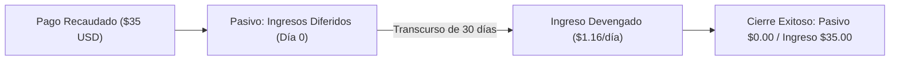

# Modelo Financiero & Conciliación — Care Ads Manager V1.0

## 1. Principio Contable: Ingreso Diferido vs Devengado

En publicidad digital contratada por adelantado:
- **Al Recibir el Pago**: El dinero entra a bancos/pasarela y se reconoce contablemente un **Pasivo por Ingresos Diferidos** (Servicio Publicitario No Devengado). CareTech tiene una obligación de entrega pendiente.
- **Durante la Emisión**: A medida que transcurren los días de vigencia (Modelo A) o se entregan las impresiones pactadas (Modelo C), se devenga proporcionalmente el ingreso hacia la cuenta de resultados (Ingresos Operacionales).
- **Al Cierre de la Campaña**: Si el servicio se ejecutó satisfactoriamente, el pasivo se amortiza al 100%. Si hubo incumplimiento técnico o cancelación antes de inicio, se genera la nota de crédito o compensación correspondiente.

---

## 2. Tipos de Datos y Precisión Decimal
- **Regla Estricta**: No usar `FLOAT` ni `REAL` bajo ninguna circunstancia para valores monetarios.
- **Base de Datos**: `NUMERIC(12, 2)` para montos de facturación y `NUMERIC(10, 4)` para cálculos de CPM / costo por segundo.
- **Backend Python**: Objeto `decimal.Decimal` con redondeo estándar bancario (`ROUND_HALF_UP`).

---

## 3. Estructura de Conciliación de Pasarelas

Cada transacción de pago registrada en la tabla `payments` debe cruzar contra el reporte oficial de la pasarela:

| Pasarela | Identificador de Cruce | Validación de Integridad |
| :--- | :--- | :--- |
| **ePayco** | `x_ref_payco` / `x_transaction_id` | Firma HMAC SHA-256 (`x_signature == sha256(p_cust_id + p_key + ref + amount + currency)`) |
| **PayPal** | `txn_id` / `invoice` | Verificación de mensaje IPN (`cmd=_notify-validate` responde `VERIFIED`) |
| **MercadoPago** | `data.id` (Payment ID) | Consulta directa a API `/v1/payments/{id}` con Secret Access Token |
| **Binance Pay** | `prepayId` / `merchantTradeNo` | Verificación de firma Binance Pay Webhook con llave pública Binance |

---

## 4. Métricas de Control Financiero (Dashboard)
1. **Total Recaudado (Cash In)**: Suma de todos los pagos con estado `CAPTURED`.
2. **Ingresos Devengados**: Valor correspondiente a los días de servicio ya ejecutados.
3. **Ingresos Diferidos Pendientes**: Saldo de campañas activas aún en curso.
4. **Cuentas por Cobrar**: Órdenes en estado `CONTRACT_ACCEPTED` con pago pendiente.
5. **Compensaciones Acumuladas**: Valor monetario de prórrogas o reposiciones otorgadas.
