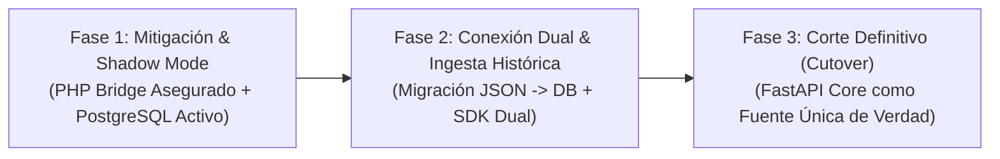

# Plan de Migración & Convivencia (Shadow Mode) — Care Ads Manager V1.0

## 1. Estrategia de Migración Gradual Sin Caídas
Para garantizar cero tiempo de inactividad (*zero downtime*) y proteger la operación de los juegos en vivo (`solitario`), la transición se estructura en 3 fases:

---

## 2. Fase 1: Mitigación Inmediata y Modo Sombra (Completada)
1. **Mitigaciones en PHP Bridge**:
   - `SEC-04`: Nuevas campañas registradas en `/publicidad/` ya no nacen como `ACTIVE`, sino como `PENDING_REVIEW`.
   - `SEC-02` y `SEC-03`: Endpoints de administración de llaves ePayco y estadísticas de dispositivos quedan bloqueados tras validación estricta de token administrativo (`verifyAdminAuth()`).
2. **Despliegue de Base de Datos y Backend**:
   - PostgreSQL (`care_ads_db`) y FastAPI operan en paralelo sin interferir con el tráfico estático de Hostinger.

---

## 3. Fase 2: Ingesta Histórica y Validación Cruzada
1. **Extracción e Ingesta de JSON**:
   - Ejecución del script `care-ads/scripts/migrate_legacy_json.py` para sincronizar cualquier campaña o pago histórico hacia PostgreSQL con validación idempotente.
2. **Verificación de Auditoría**:
   - Cada registro histórico migrado genera un evento de auditoría sellado en la cadena SHA-256.

---

## 4. Fase 3: Corte Definitivo (Cutover)
1. El archivo `api.php` en el servidor web actúa como proxy inverso ligero hacia `http://127.0.0.1:8000/api/v1/delivery/decision`.
2. Las llamadas de los juegos PWA reciben respuestas generadas exclusivamente por el motor de decisión de Care Ads Manager V1.0.
3. Se deshabilitan las escrituras locales a `campaigns.json` y `payments.json`, quedando como respaldos de sólo lectura archivados.
